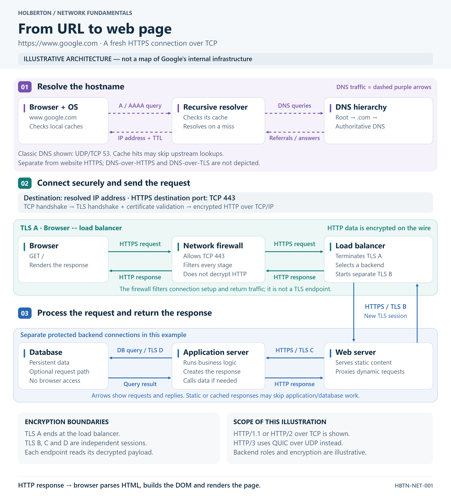

# What Happens When You Type a URL and Press Enter?

This project explains the infrastructure behind navigating to
`https://www.google.com`, from DNS resolution to the rendered page.

## Task 0: What happens when...

Read the [published article on Medium](https://medium.com/@anthonycaban1010/what-happens-when-you-type-https-www-google-com-in-your-browser-and-press-enter-080383ce98f8)
or its source in [blog_post.md](./blog_post.md).
It covers all eight required topics:

| Required topic | Article section |
| --- | --- |
| DNS request | 2. DNS finds an IP address |
| TCP/IP | 3. TCP/IP carries the conversation |
| Firewall | 4. Firewalls decide which traffic is allowed |
| HTTPS/SSL | 5. HTTPS uses TLS to secure the connection |
| Load-balancer | 6. The HTTP request reaches a load balancer |
| Web server | 7. The web server handles HTTP |
| Application server | 8. The application server runs the logic |
| Database | 9. Databases and indexes supply stored information |

The article also explains URL parsing, HTTP/3 over QUIC, caching, and browser
rendering. It distinguishes general architectural examples from documented
Google behavior. Technical sources are linked beside the relevant explanations.

## Task 0: publication and submission

**Status: published on Medium.**

[0-blog_post](./0-blog_post) contains the public article URL as a single line,
followed by a newline. The article and README are written in English.

Submit the same **Medium article URL** in the intranet field. GitHub stores the
answer file and article source; the submitted blog URL points to Medium.

## Task 1: infrastructure diagram

**Status: PASS — the PNG and SVG are published on GitHub, the direct PNG URL
is verified, and the image appears in the published Medium article.**

The [PNG](./diagram/web-request-flow.png) is the publication artifact.
The [editable SVG source](./diagram/web-request-flow.svg) retains text, shapes,
arrows, and logical groups as vector objects. The diagram is in English.
It describes an illustrative architecture, not Google's internal deployment.

### Visual requirements

| Requirement | Representation |
| --- | --- |
| Browser and DNS resolution | A separate purple lane shows the client, recursive resolver, and DNS hierarchy. |
| DNS versus HTTPS | DNS queries and returning referrals/answers use dashed purple arrows; website HTTPS uses solid teal arrows. Classic UDP/TCP 53 DNS is shown; DoH/DoT is outside the diagram's scope. |
| Destination address and port | The connection uses the resolved IP address and destination TCP port 443; no Google IP is invented. |
| TCP/IP and TLS | TCP setup precedes TLS negotiation and certificate validation; HTTP data then travels encrypted over TCP/IP. |
| Firewall | The network firewall allows TCP 443 and filters both connection setup and replies without terminating TLS. |
| Load balancer | It terminates the browser's TLS session A, selects a backend, and starts separate TLS session B. |
| Web and application servers | The web server serves static content or proxies application work; the application server runs logic and creates the response. |
| Database | A private data layer receives application queries; database access is optional for a particular request. |
| Encryption boundaries | TLS A ends at the load balancer. TLS B, C, and D are independent backend connections in this example, with decryption at each endpoint. |
| Returning response | Explicit reply arrows lead back through the web server, load balancer, and firewall to the browser. Database replies are query results, not browser HTTP responses. |

HTTP/1.1 or HTTP/2 over TCP is illustrated. HTTP/3 uses QUIC over UDP and is
identified as an alternative rather than incorrectly drawn as a TCP flow.
Backend encryption is an explicit choice for this illustration; the diagram
does not claim it proves Google's configuration or encryption at rest.

Technical references: [DNS](https://www.rfc-editor.org/rfc/rfc1035.html),
[TCP](https://www.rfc-editor.org/rfc/rfc9293.html),
[TLS 1.3](https://www.rfc-editor.org/rfc/rfc8446.html),
[HTTP/3](https://www.rfc-editor.org/rfc/rfc9114.html), and
[separate client-side and server-side TLS](https://www.haproxy.com/documentation/haproxy-configuration-tutorials/security/ssl-tls/basics-enable-tls/).

### Publication and Medium placement

The [task 1 answer file](./1-what_happen_when_diagram) contains only the
[verified public PNG URL](https://raw.githubusercontent.com/anthocab2/holbertonschool-network/5b6de64e3c179b46cbdc1bc4fb7c2b3ffc73e74a/what_happens_when_your_type_google_com_in_your_browser_and_press_enter/diagram/web-request-flow.png),
followed by one newline. This immutable URL points to the published image
commit, not a GitHub HTML preview page. On 8 November 2026, an unauthenticated
request returned HTTP 200 and `image/png`; its SHA-256 matched the approved
local PNG, and the browser decoded it at 3200 × 3520 pixels.

The PNG and SVG were published in
[commit 5b6de64](https://github.com/anthocab2/holbertonschool-network/commit/5b6de64e3c179b46cbdc1bc4fb7c2b3ffc73e74a).
On 8 November 2026, the PNG was inserted in the
[published Medium article](https://medium.com/@anthonycaban1010/what-happens-when-you-type-https-www-google-com-in-your-browser-and-press-enter-080383ce98f8)
**after its second introductory paragraph, immediately before
“1. The browser understands the address.”** The update was saved and published.
The public article view loaded the image, caption, and descriptive alt text;
all 44 original article text blocks matched their pre-edit values exactly.

Caption: *Illustrative DNS and HTTPS request flow, with TLS termination and
separate backend connections.*

Alt text: “DNS returns an address to the browser. HTTPS over TCP 443 passes
through a firewall to a load balancer, where the browser’s TLS session ends.
Separate TLS connections link the web server, application server, and database.
Reply arrows return the response to the browser.”

Medium placement was verified in the published page using the signed-in
browser. An additional unauthenticated command-line request returned HTTP 403,
so that separate retrieval method could not verify Medium. The GitHub PNG
was independently verified without authentication. PASS covers the requested
publication checks; it does not imply approval by the private checker or an
intranet submission.

## Files

| File | Purpose |
| --- | --- |
| `0-blog_post` | Public Medium article URL for task 0 |
| `blog_post.md` | Complete article source with technical references |
| `diagram/web-request-flow.png` | English infrastructure diagram for publication |
| `diagram/web-request-flow.svg` | Editable vector source for the diagram |
| `1-what_happen_when_diagram` | Verified public direct PNG URL, followed by one newline |
| `README.md` | Project overview, topic coverage, and submission instructions |

Task 0 was checked against the eight required topics. Its published page,
answer-file format, and documentation links were verified. The intranet review
has not been performed.

The directory spelling matches the assignment exactly:
`what_happens_when_your_type_google_com_in_your_browser_and_press_enter`.
